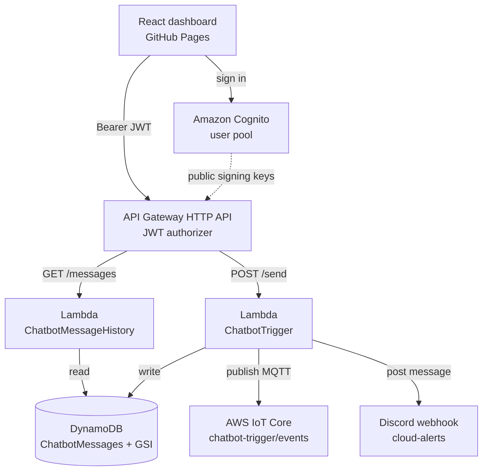
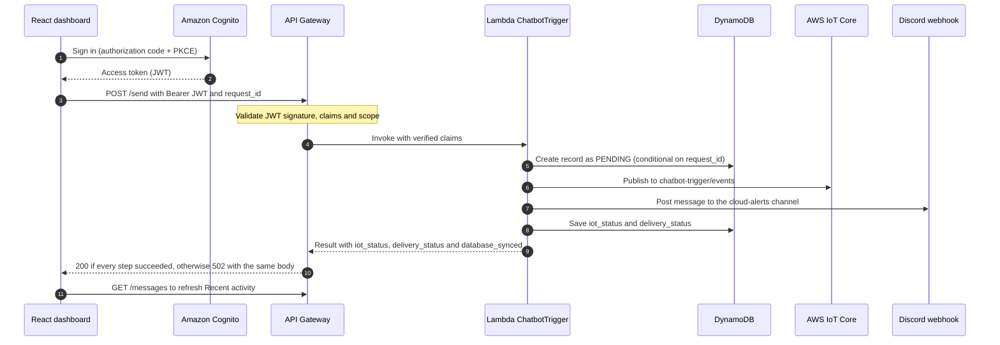

# CloudTrigger — Cloud Chatbot Trigger

**AWS Academy Cloud Computing project · serverless messaging · software-only**

[Live dashboard](https://syedrehanuddin.github.io/CloudChatbotTrigger/) · [Source](https://github.com/SyedRehanuddin/CloudChatbotTrigger) · [Backend notes](backend/README.md)

CloudTrigger is a secured messaging dashboard built with **React + Vite** on real AWS services. A signed-in user types a message and sends it through **API Gateway** to **AWS Lambda**. The Lambda stores the message and its delivery state in **DynamoDB**, publishes an MQTT event to **AWS IoT Core**, and posts the message to a **Discord** channel. The dashboard shows the result of each step and reads the user's recent messages back from DynamoDB.

It demonstrates:

- **Authentication and authorization** with Amazon Cognito (admin-created users) and a JWT authorizer on API Gateway.
- **Serverless backend** with two Lambda functions, DynamoDB (including a global secondary index) and IoT Core.
- **Safe retries:** each send carries a UUID `request_id`, so an uncertain request can be retried and the backend checks its stored state instead of sending again. This reduces the risk of duplicates; it is not an exactly-once guarantee (see Limitations).
- **Per-user data:** the history endpoint reads only the signed-in user's records.
- **Honest status reporting:** the UI shows only what the backend reports for each step.

> **Software-only:** the web dashboard replaces the physical trigger button of the original project idea. IoT Core publishing was verified in the AWS **MQTT Test Client**; nothing in this project runs a physical MQTT subscriber.

> **Access:** the site is public, but sending and reading messages needs an **admin-created Cognito account**. The backend runs in an **AWS Academy Learner Lab**, so it is unavailable whenever the lab session is stopped. The static site on GitHub Pages stays online either way.

## Screenshots

**Authenticated message trigger and execution pipeline** (live GitHub Pages verification, 1 November 2026):


**DynamoDB-backed Recent activity** (live GitHub Pages verification, 1 November 2026; cropped to show recent results):


## How it works



Sending a message, in order:



1. **Sign-in:** Cognito authenticates the user and issues an access token. API Gateway verifies the JWT before it invokes either Lambda.
2. **`POST /send`:** `ChatbotTrigger` validates the request, writes a `PENDING` record, publishes to IoT Core, posts to Discord, then saves the final statuses. These steps run one after another. IoT Core only publishes the MQTT event; the Discord post is a separate webhook call made by Lambda.
3. **Status codes:** the Lambda returns `200` only when IoT publishing and Discord both succeeded **and** the final status update in DynamoDB completed (`database_synced: true`). Otherwise it returns `502` with the message ID and the per-step results: either a delivery step failed, or delivery succeeded but the final status update did not.
4. **`GET /messages`:** `ChatbotMessageHistory` takes `user_sub` from the **JWT claims verified by API Gateway** (never from the request), queries the GSI newest first, and returns up to **eight** of that user's messages.
5. **Refresh:** the dashboard reloads history after each send. The GSI is eventually consistent, so a new row can take a moment to appear; the refresh button covers that.

## Using the dashboard

| Area | What it shows |
|---|---|
| **Message trigger** | The composer (500 characters max) with quick sample messages. |
| **Execution pipeline** | Five results for the latest request: Cognito/API Gateway `AUTHORIZED`, Lambda `EXECUTED`, DynamoDB `STORED`, IoT Core `PUBLISHED`, Discord `SENT`, as reported by the backend. Below them: the **Last message ID** (with a copy button) and the HTTP status. |
| **Counters** | These are recent-window statistics for the **latest eight** DynamoDB records, not lifetime totals. *Recent requests* is at most eight: once eight records exist it stays at eight while newer messages replace older ones. *Discord sent* and *MQTT published* count only the successful results among those records, so they can be lower than eight. Failed or pending records are never counted as sent or published. "Discord sent" means the webhook accepted the post. |
| **Recent activity** | The latest eight messages for the signed-in user, each with its time and MQTT/Discord status. |
| **Architecture** | Diagrams of the send and history flows. |

The breadcrumb in the top bar follows the section chosen in the sidebar. **Sign out** clears the local session and ends the Cognito hosted session.

### Troubleshooting

| What you see | What it means | What to do |
|---|---|---|
| Error with HTTP 500/502/503 plus a Learner Lab suggestion | The backend did not answer properly. **A stopped Learner Lab is one possible cause**, not a confirmed one. | Start the lab session and try again. |
| *Request timed out* or *Could not confirm the AWS result* | The message may or may not have been processed. | Use **Retry / check same request**. It reuses the same ID, so the backend checks its stored state instead of sending again, which reduces the risk of duplicate delivery. |
| **Unresolved request** banner | An earlier send was not confirmed. Its ID is kept in this browser tab, even across a refresh. | Retry with the same message. Use **Start new request** only if you really want a new message. |
| HTTP 502 with a message ID | The record was stored, but a delivery step or the final DynamoDB status update failed. The pipeline shows which step; a warning appears if the status update did not complete. | Check the statuses. Retrying the same ID reports the stored result and will **not** resend. |
| *API access denied* or *session is not authorized* | The token expired or is invalid. | Sign in again. A pending request ID is kept for a safe retry. |
| *Too many requests* / history *temporarily limited* | Route throttling. | Wait a second and retry. |
| New message missing from Recent activity | The GSI is eventually consistent. | Press the refresh button. |

## Technology stack

| Layer | Technology | Role |
|---|---|---|
| Frontend | React, Vite, JavaScript, CSS, lucide-react | Composer, pipeline, history, architecture view |
| Authentication | Amazon Cognito, `react-oidc-context`, `oidc-client-ts` | OIDC sign-in and sign-out, access tokens |
| API | Amazon API Gateway HTTP API | JWT-protected routes, per-route throttling, CORS |
| Compute | AWS Lambda (Python 3.13) | Message processing and history queries |
| Storage | Amazon DynamoDB | Message and delivery records, per-user index |
| Messaging | AWS IoT Core (MQTT) | Events on `chatbot-trigger/events` |
| Notification | Discord webhook | Message posted to `#cloud-alerts` |
| Hosting | GitHub Pages + GitHub Actions | Static frontend deployment |

## API reference

Base URL used by the deployed frontend:

```text
https://s2fqrsa25m.execute-api.us-east-1.amazonaws.com
```

| Route | Authorization | Purpose |
|---|---|---|
| `POST /send` | Cognito JWT (`openid` scope) | Store, publish and deliver one message |
| `GET /messages` | Cognito JWT (`openid` scope) | Latest eight messages owned by the caller |

Anonymous calls to either route return `401`.

**`POST /send` request:**

```json
{
  "message": "Testing CloudTrigger from the dashboard",
  "request_id": "20efaf8b-f5d3-4bb9-be4a-3b9569a7428a"
}
```

`message` is required (1–500 characters). `request_id` is an optional UUID; the dashboard always sends one. It becomes the DynamoDB `message_id`. Sending the same `request_id` again reports the stored result instead of sending anything new, and it must carry the **same message**. Each new message needs a freshly generated `request_id` (the dashboard does this automatically); reusing one with different text returns `409`.

| Status | Meaning |
|---|---|
| `200` | Stored, published to IoT Core and sent to Discord. |
| `202` | An earlier request with this ID is still `PENDING`. Nothing new was sent. |
| `400` | Invalid body, empty or too-long message, or `request_id` is not a UUID. |
| `401` / `403` | Missing, invalid or insufficient token. |
| `409` | This `request_id` was already used for a different message or user. |
| `429` | Route throttle exceeded. |
| `500` | The record could not be saved, or another backend error occurred. |
| `502` | The record was stored, but a delivery step or the final DynamoDB status update failed. Check `iot_status`, `delivery_status` and `database_synced` in the body. |

**`GET /messages` response** (format illustration, not real data):

```json
{
  "status": "SUCCESS",
  "count": 1,
  "messages": [
    {
      "message_id": "20efaf8b-f5d3-4bb9-be4a-3b9569a7428a",
      "message": "Testing CloudTrigger from the dashboard",
      "timestamp": "2026-10-31T11:31:50+00:00",
      "status": "STORED",
      "iot_status": "PUBLISHED",
      "delivery_status": "SENT"
    }
  ]
}
```

## Run the frontend locally

**Prerequisites:** Node.js 22 or newer (CI builds with Node 24) and npm; an authorized Cognito account; a running Learner Lab backend.

```powershell
npm ci
npm run dev -- --host localhost --port 8000 --strictPort
```

Open **http://localhost:8000/**. Port `8000` is intentional: it is a registered Cognito callback/logout URL and an allowed CORS origin. A different port will fail sign-in.

```powershell
npm run lint     # oxlint
npm run build    # production build in dist/ (base path /CloudChatbotTrigger/)
```

### Authentication configuration

The public Cognito settings are in `src/main.jsx`. **User pool and client IDs are public identifiers, not secrets.** The app client is a public SPA client with no client secret, uses the authorization code flow, and the pool is admin-create-only.

Registered callback and logout URLs:

```text
http://localhost:8000/
https://syedrehanuddin.github.io/CloudChatbotTrigger/
```

Never commit passwords, tokens, a client secret, webhook URLs or `.env` files.

## Repository layout

```text
.
├── src/                          React app (App.jsx, App.css, main.jsx holds the Cognito config)
├── backend/
│   ├── chatbot_trigger/          POST /send Lambda and its mocked tests
│   ├── chatbot_message_history/  GET /messages Lambda
│   ├── optional/                 optional hardening patch (see backend/README.md)
│   └── README.md                 deploy, drift-check and test instructions
├── screenshots/                  images used in this README
├── .github/workflows/deploy.yml  GitHub Pages deployment
└── vite.config.js, package.json, .oxlintrc.json
```

The Lambdas are deployed by pasting the code into the AWS console. GitHub Actions does not deploy them; `backend/` is the reviewable copy of what runs in AWS.

## Deployment

GitHub Actions runs on every push to `main`: it installs dependencies, builds the Vite site and publishes `dist/` to GitHub Pages. Repository **Settings → Pages → Source** must be **GitHub Actions**.

> The workflow deploys **only the static frontend**. It does not create or change Lambda, API Gateway, Cognito, DynamoDB, IoT Core or Discord resources; those were set up by hand in AWS Academy.

### AWS resources (us-east-1)

| Service | Resource / setting |
|---|---|
| Cognito user pool | `us-east-1_NC9MZPOmc` |
| Cognito app client | `15ef6nd851a6mepd49qlojrobr` (public SPA client) |
| API Gateway | `ChatbotTriggerAPI`, HTTP API `s2fqrsa25m` |
| POST Lambda | `ChatbotTrigger`, Python 3.13, timeout **20 s** |
| GET Lambda | `ChatbotMessageHistory`, Python 3.13, timeout **15 s** |
| DynamoDB table | `ChatbotMessages`, on-demand, key `message_id` (String) |
| History GSI | `user-sub-timestamp-index` (partition `user_sub`, sort `timestamp`) |
| IoT topic | `chatbot-trigger/events` |
| Discord | Webhook for `#cloud-alerts`; the URL lives only in Lambda configuration |

## Security notes

- `GET /messages` sits behind the Cognito JWT authorizer and reads only the caller's own records. `user_sub` comes from verified claims, never from a request parameter.
- CORS allows only `http://localhost:8000` and `https://syedrehanuddin.github.io`. **CORS is not authentication**; the JWT authorizer is.
- Throttling per route: `POST /send` 1 request/s (burst 2), `GET /messages` 2 requests/s (burst 5). This is a safety measure, not abuse protection.
- The Discord payload blocks all mentions (`allowed_mentions` is empty), and the webhook host is checked before any request is made.
- AWS calls inside the Lambda have short timeouts, and a failed IoT or Discord step is reported as failed instead of being hidden.
- The webhook URL is never stored in Git, screenshots or logs. Rotate any webhook or password that has been exposed.

## Verification

Evidence is split by type so it is clear what was checked against live AWS and what was only mocked.

| Check | Type | When |
|---|---|---|
| Sign-in on the live Pages site, then `POST /send` returned `200` | Live AWS | Oct 2026 |
| Message ID and text matched across the dashboard, the MQTT Test Client and Discord `#cloud-alerts` | Live AWS | Oct 2026 |
| Record read directly from `ChatbotMessages` with `user_sub`, `timestamp`, `iot_status=PUBLISHED`, `delivery_status=SENT` | Live AWS | Oct 2026 |
| `GET /messages` returned `200` / `SUCCESS`; the dashboard showed the DynamoDB records and their statuses | Live AWS | Oct 2026 |
| Anonymous `GET /messages` returned `401` | Live AWS | Oct 2026 |
| CORS preflight from the Pages origin returned `204` with the required headers | Live AWS | Oct 2026 |
| Route throttles read back from `get-stage` (1/s burst 2 and 2/s burst 5) | AWS configuration | Oct 2026 |
| Full cycle on GitHub Pages: sign in, load history, send, check all delivery statuses, sign out through Cognito, sign in again; message IDs matched Discord | Live AWS | 31 Oct 2026 |
| Polished dashboard on GitHub Pages: message sent with HTTP `200` and all five pipeline statuses; Recent activity loaded from DynamoDB | Live AWS | 1 Nov 2026 |
| 30 checks for `ChatbotTrigger`: success path, invalid requests, each downstream failure, look-alike webhook hosts, mention blocking, webhook token kept out of logs, idempotent retries, bounded AWS timeouts | **Mocked** (simulated DynamoDB, fake IoT and Discord) | see `backend/README.md` |

The mocked tests do not contact AWS and do not prove the live deployment works. A retry after a real network failure was **not** exercised against live AWS; the backend side of retries is covered only by the mocked tests.

## Limitations and scope

- **Software-only:** there is no ESP32, button or on-device subscriber. IoT publishing was observed in the MQTT Test Client; publishing alone is not delivery to hardware.
- **Learner Lab dependency:** the public site stays visible when the lab is stopped, but sends and history reads fail until the lab and its AWS resources are running again.
- **Latest eight only:** history and counters cover the newest eight records of the signed-in user. Records created before `user_sub` was stored are not in the per-user index.
- **Eventual consistency:** a new record can appear in the GSI a moment after it is sent; use Refresh.
- **Bounded deduplication:** retries reuse a UUID, but exactly-once delivery is not promised. If Discord accepts a message and the final DynamoDB update then fails, the record can stay `PENDING` (see `backend/optional/pending-fix.patch`).
- **Not infrastructure-as-code:** the Lambda source is in the repo, but API Gateway, Cognito, DynamoDB (including the GSI) and IoT Core were created by hand in the console. Rebuilding means recreating them manually.

Possible next steps: describe the AWS resources with AWS SAM or CloudFormation, and run lint and the backend tests in GitHub Actions.

## Demo checklist

1. Start the AWS Academy Learner Lab and confirm the resources are available.
2. Open the live site and sign in with an authorized Cognito account.
3. In AWS IoT Core, subscribe in the **MQTT Test Client** to `chatbot-trigger/events`.
4. Open Discord's `#cloud-alerts` channel.
5. Send a short custom message and walk through the pipeline: authorized, executed, stored, published, sent.
6. Show the MQTT payload and the Discord message, and match the message ID using the copy button.
7. Open **Recent activity** and refresh to show the record read from DynamoDB; point out that the counters cover the latest eight.
8. Open **Architecture** to show the send and history flows.
9. **Sign out** to demonstrate the Cognito hosted logout.

If the lab cannot be started, show the screenshots above and the code in `backend/` instead.
