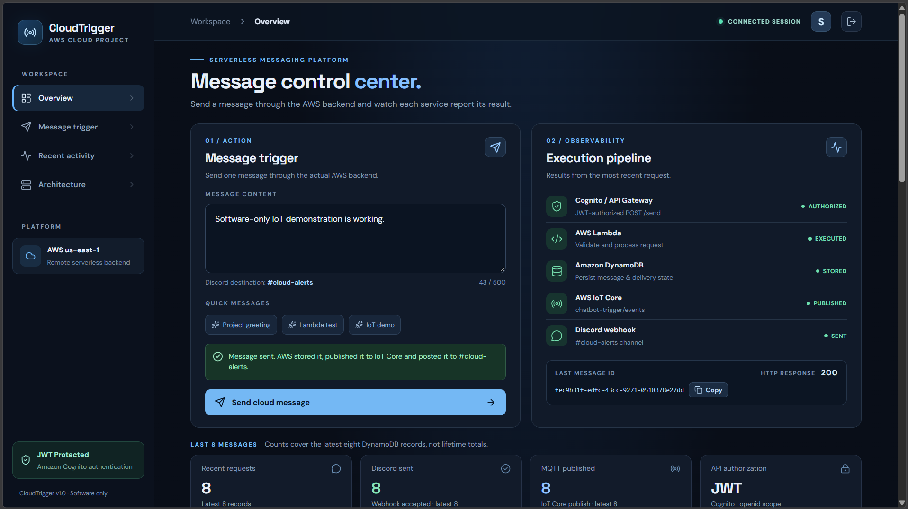
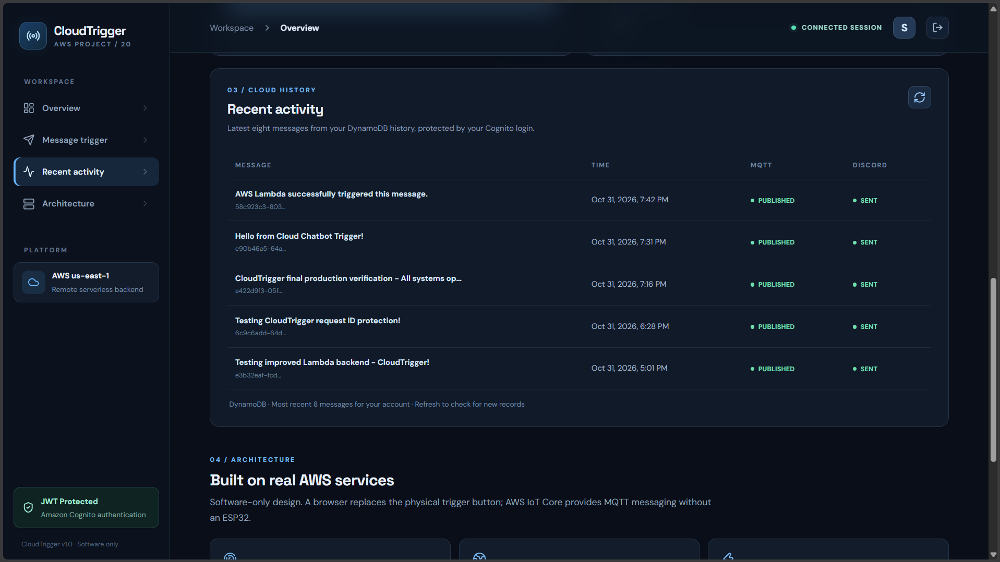
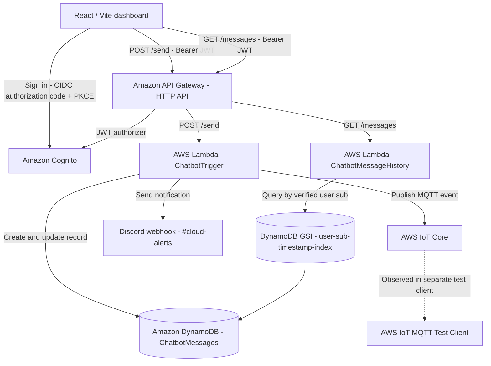

# CloudTrigger — Cloud Chatbot Trigger

**Product #20 · AWS Academy Cloud Computing · Software-only serverless messaging**

CloudTrigger is a secured messaging dashboard built with **React + Vite** and real AWS services. An authorized user signs in with **Amazon Cognito**, types a message, and sends it through **API Gateway** to **AWS Lambda**. The Lambda stores message and delivery state in **Amazon DynamoDB**, publishes an MQTT event to **AWS IoT Core**, and sends the message to a **Discord webhook**. The dashboard shows the execution results and retrieves the user's recent messages directly from DynamoDB.

This is a **software-only implementation**: the web dashboard provides the trigger instead of an ESP32 button. AWS IoT Core publishing has been verified with its **MQTT Test Client**; the application does **not** itself operate a physical MQTT subscriber.

## Live application

- **Dashboard:** https://syedrehanuddin.github.io/CloudChatbotTrigger/
- **Repository:** https://github.com/SyedRehanuddin/CloudChatbotTrigger

> The site is publicly accessible, but **sending and reading messages requires an authorized Cognito account**. The AWS backend is hosted in an AWS Academy Learner Lab, so it may be unavailable when the lab session is stopped or resources are unavailable. GitHub Pages remains online independently.

## Screenshots

**Authenticated message trigger and execution pipeline** (local development verification):



**Live DynamoDB-backed Recent Activity** (local development verification):



## Architecture



### Request flow

1. **Cognito** signs in the user and provides an access token. **API Gateway** checks the JWT before invoking either Lambda.
2. **`POST /send`** calls `ChatbotTrigger`. The Lambda validates the request, writes a DynamoDB record, attempts AWS IoT Core publishing and Discord delivery, updates message status, and returns the outcome.
3. The frontend displays **authorized / executed / stored / published / sent** results only as reported by the backend. A returned HTTP `200` indicates the successful tested path, not a guarantee that arbitrary future requests cannot fail.
4. **`GET /messages`** invokes `ChatbotMessageHistory`. It derives `user_sub` from the **API Gateway-validated JWT claims**, queries the GSI in descending timestamp order, and returns up to **eight recent messages** owned by that user.
5. The React dashboard refreshes cloud history after sending and provides a manual refresh action. Index updates can be **eventually consistent**.

## Technology stack

| Layer | Technology | Role |
|---|---|---|
| Frontend | React, Vite, JavaScript, CSS, lucide-react | Message composer, status pipeline, history, architecture view |
| Authentication | Amazon Cognito, `react-oidc-context`, `oidc-client-ts` | OIDC sign-in/sign-out and access tokens |
| API | Amazon API Gateway HTTP API | JWT-protected routes, throttling and CORS |
| Compute | AWS Lambda (Python 3.13) | Message processing and history queries |
| Storage | Amazon DynamoDB | Persistent message and delivery records |
| Messaging | AWS IoT Core (MQTT) | Event publication to `chatbot-trigger/events` |
| Notification | Discord webhook | Message delivered to `#cloud-alerts` |
| Hosting | GitHub Pages + GitHub Actions | Static frontend deployment |

## Main features

- **Authenticated messaging:** admin-provisioned Cognito users; protected API calls.
- **Serverless delivery:** Lambda coordinates DynamoDB storage, MQTT publishing, and Discord posting.
- **Observable outcomes:** the UI distinguishes processing and each downstream operation.
- **Cloud history:** up to eight newest DynamoDB records for the signed-in user's Cognito `sub`.
- **Safe request retries:** each new send uses a UUID `request_id`; an **uncertain** request keeps its original ID for retry/deduplication. A confirmed send is cleared. This is not a guarantee of exactly-once delivery in all backend crash scenarios.
- **Cognito hosted logout:** clears local session and redirects through Cognito's configured logout endpoint.
- **Input and API safeguards:** 500-character composer limit, JWT authorization, API throttling and specific CORS origins.

## API interface

Base URL used by the deployed frontend:

```text
https://s2fqrsa25m.execute-api.us-east-1.amazonaws.com
```

| Route | Authorization | Purpose |
|---|---|---|
| `POST /send` | Cognito JWT, `openid` scope | Store, publish and deliver a message |
| `GET /messages` | Cognito JWT, `openid` scope | Retrieve up to eight most recent messages owned by the authenticated user |

Example **request body** for `POST /send` (do not put real credentials in examples):

```json
{
  "message": "Testing CloudTrigger from the dashboard",
  "request_id": "6c9c6add-64d4-4a7a-80f7-a6b2c614adb1"
}
```

The `request_id` is an optional UUID understood by the hardened Lambda; the current frontend supplies it automatically. A retry of an unresolved request must reuse **both the same ID and the same message**. API Gateway requires a valid bearer access token; anonymous calls to either route return `401`.

The history endpoint returns the following shape on success:

```json
{
  "status": "SUCCESS",
  "count": 1,
  "messages": [
    {
      "message_id": "6c9c6add-64d4-4a7a-80f7-a6b2c614adb1",
      "message": "Testing CloudTrigger from the dashboard",
      "timestamp": "2026-10-31T11:31:50+00:00",
      "status": "STORED",
      "iot_status": "PUBLISHED",
      "delivery_status": "SENT"
    }
  ]
}
```

This is a **format illustration**, not a claim that the illustrative message exists in the database.

## Run frontend locally

**Prerequisites:** Node.js 22 or newer and npm; access to the Cognito account created for this project; a currently available AWS Learner Lab backend.

From the repository root (this repository contains the frontend project):

```powershell
npm ci
npm run dev -- --host localhost --port 8000 --strictPort
```

Open **http://localhost:8000/**. Port `8000` is intentional: it is an authorized Cognito callback/logout URL and an allowed API CORS origin. Running bare `npm run dev` may choose a different port unless the Vite config is updated to set `server.port`.

Production build:

```powershell
npm run build
```

Built files are produced in `dist/`. Vite uses `/CloudChatbotTrigger/` as the production base path for GitHub Pages.

### Authentication configuration

The public Cognito SPA configuration is embedded in `src/main.jsx` (issuer/client and redirect settings). **Client IDs and pool IDs are public identifiers, not passwords.** The account is set up for admin-created users rather than open registration.

Approved callback and logout URLs:

```text
http://localhost:8000/
https://syedrehanuddin.github.io/CloudChatbotTrigger/
```

Never commit test passwords, access or refresh tokens, a client secret, webhook tokens, or `.env` files containing credentials.

## Backend source and tests

`backend/` holds the source of both Lambda functions and the mocked tests for `ChatbotTrigger`. Lambdas are deployed by pasting the code into the AWS console; GitHub Actions does not deploy them. See [`backend/README.md`](backend/README.md) for deploying, checking that the deployed code matches the repo, and running the tests.

## GitHub Pages deployment

The repo includes `.github/workflows/deploy.yml`. GitHub Actions runs on pushes to `main`, installs dependencies, builds the Vite site, and deploys `dist/` to GitHub Pages.

Repository **Settings → Pages → Build and deployment → Source** must be **GitHub Actions**.

```powershell
npm run build
git add .
git commit -m "docs: document CloudTrigger architecture and demo"
git push origin main
```

> GitHub Actions deploys **only the static frontend**. It does not create, update, or reactivate Lambda, API Gateway, Cognito, DynamoDB, IoT Core or Discord resources. Those resources were configured separately in AWS Academy.

## AWS resources used (us-east-1)

| Service | Resource / setting |
|---|---|
| Cognito user pool | `us-east-1_NC9MZPOmc` |
| Cognito app client | `15ef6nd851a6mepd49qlojrobr` (public SPA client) |
| API Gateway | `ChatbotTriggerAPI`, HTTP API ID `s2fqrsa25m` |
| POST Lambda | `ChatbotTrigger`, Python 3.13, timeout **20 s** |
| GET Lambda | `ChatbotMessageHistory`, Python 3.13, timeout **15 s** |
| DynamoDB table | `ChatbotMessages`, on-demand, primary key `message_id` (String) |
| History GSI | `user-sub-timestamp-index`, partition key `user_sub`, sort key `timestamp` |
| AWS IoT topic | `chatbot-trigger/events` |
| Discord | Webhook for `#cloud-alerts` channel; secret URL stored in Lambda configuration, **never in Git** |

### Operational security

- `GET /messages` is protected by the existing Cognito JWT authorizer and reads **only** the authenticated user's partition. Do not accept a caller-supplied `user_sub` in place of JWT claims.
- API Gateway allows browser origins `http://localhost:8000` and `https://syedrehanuddin.github.io`, with `authorization` and `content-type` request headers. **CORS is not authentication.**
- Route throttling is configured per route: `POST /send` allows **1 request per second, burst 2**, and `GET /messages` allows **2 requests per second, burst 5**. Rate limiting is a safety measure, not a quota or abuse-proof guarantee.
- The Cognito client has no client secret, uses authorization code flow, and the user pool was verified as **admin-create-only**.
- The Lambda's Discord payload blocks role/everyone mentions, and the updated code isolates downstream failures rather than claiming a delivery success that did not occur.
- Avoid placing webhook URLs in source files, screenshots, README files, logs, or issues. Rotate any webhook or password that has been exposed.

## Verified behavior

The following was observed in **October 2026** with AWS Academy resources active:

- **Live GitHub Pages sign-in and POST:** Cognito-authenticated request returned HTTP `200`.
- **Live downstream checks:** message ID and message content matched between frontend results, AWS IoT MQTT Test Client, and Discord `#cloud-alerts`.
- **DynamoDB storage:** a record was retrieved directly from `ChatbotMessages`, including `user_sub`, `timestamp`, `iot_status=PUBLISHED`, and `delivery_status=SENT`.
- **History endpoint:** `ChatbotMessageHistory` returned HTTP `200` and `status=SUCCESS` with a stored message.
- **React cloud history:** the locally running dashboard displayed DynamoDB records and their reported IoT and Discord statuses.
- **Request-ID frontend:** an ordinary send completed with HTTP `200`, and the new record appeared in cloud history. A simulated uncertain network failure/retry was **not** established by this successful-path test.
- **Unauthenticated route access:** request to `GET /messages` returned HTTP `401`.
- **Pages-origin CORS preflight:** returned HTTP `204` with GET/POST/OPTIONS and the required headers.
- **Route throttling:** `get-stage` shows `POST /send` at 1 request/s (burst 2) and `GET /messages` at 2 requests/s (burst 5).
- **Automated backend tests (mocked, not live):** `backend/` has 30 checks for `ChatbotTrigger` using a simulated DynamoDB and fake IoT/Discord. They do not contact AWS and do not prove the live deployment works; the live checks are the ones listed above.

## Limitations and scope

- **Software-only:** no ESP32, physical button, OLED or on-device subscriber is deployed. IoT publication was **received in AWS IoT Core's MQTT Test Client**; publication alone is not hardware delivery.
- **Limited history:** only the latest eight records for the signed-in user are shown. Records created **before** `user_sub` was added will not automatically appear in the new per-user index.
- **GSI consistency:** newly stored records can appear shortly after the send; use **Refresh** when needed.
- **Deduplication is bounded:** a retry of an unresolved request reuses its UUID; the backend has a known possibility of a permanently `PENDING` record if downstream delivery succeeds but the final DynamoDB update fails. Exactly-once notification is **not** promised.
- **Lab availability:** the public static site can remain visible when AWS Academy's backend is unavailable; new sends and history reads then fail until AWS resources are available.
- **Deployment reproducibility:** the two Lambda functions' source is in `backend/`, but API Gateway, Cognito, DynamoDB (including the GSI) and IoT Core were created by hand in the AWS Academy console and are not exported as infrastructure code. A full rebuild needs those resources recreated manually.

## Demo checklist

1. Start the AWS Academy Learner Lab and verify AWS resources are available.
2. Open the live GitHub Pages site and sign in with an authorized Cognito account.
3. In AWS IoT Core, subscribe in MQTT Test Client to `chatbot-trigger/events`.
4. Open Discord's `#cloud-alerts` channel.
5. Send a short custom message in CloudTrigger and show the API/Lambda/DynamoDB/IoT/Discord pipeline results.
6. Show the corresponding MQTT payload and Discord message, matching the message ID.
7. Open **Recent activity** and refresh to show the stored DynamoDB record.
8. Use **Sign Out** to demonstrate Cognito hosted logout.

---

**Project type:** AWS serverless cloud application · **Scope:** software-only college project · **Region:** `us-east-1`
